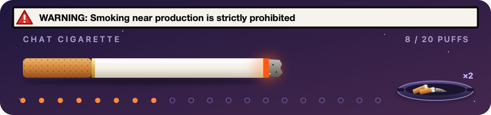
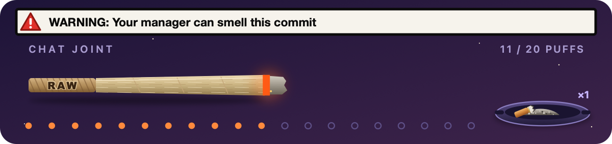
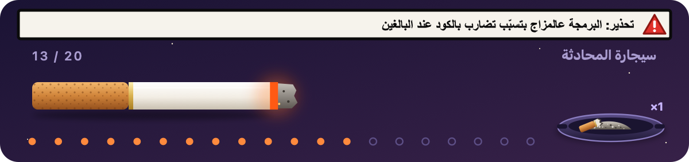

# 🚬🌿 Chat Cigarette — سيجارة المحادثة

مود لـ **Claude Code**: فوق خانة الكتابة في سيجارة (أو جوينت) بتحترق نَفَس مع كل رسالة لكلود. لما تخلص، كلود بيقلك **It's time to get some rest 🍁**، وبيطلعلك كرت مشاركة فيه أرقام يومك. بيحكي **إنجليزي، عربي وعبري**.

A Claude Code mod for the daily smoke break: a cigarette (or a joint) burns down above the prompt, one puff per message, with fake pack warnings, a daily ashtray, a share card when it burns out, late-night roasts, and your 5-hour limit and context window at a glance. English, Arabic and Hebrew.






## التركيب — Install

افتح تيرمنال، شغّل `claude`، واكتب جوّاته:

```
/plugin install chat-cigarette --marketplace Kareem1809/chat-cigarette
```

بعدها `y` (إضافة الماركتبليس) و`Enter` (الـscope). بيشتغل فوراً، وبكل جلسة جديدة، حتى بتاب Code بتطبيق Claude للديسكتوب.

> Type the install line in a terminal `claude` session (built and tested on Claude Code 2.1.295). Once installed at user scope it also loads in the desktop app's Code tab.

## التحديث — Update

من تيرمنال عادي (برّا `claude`):

```bash
claude plugin marketplace update chat-cigarette
claude plugin update chat-cigarette@chat-cigarette
```

وبعدين سكّر Claude وافتحه من جديد.

## شو فيه — What's in it

| | |
|---|---|
| 🔥 كل رسالة = نَفَس | 20 نَفَس بالسيجارة. الإشعارات ورسائل البرامج ما بتنحسب |
| ⚠️ تحذير الباكيت | شريط أبيض بإطار أسود ومثلث أحمر ⚠️ متل الباكيت الحقيقي. 10 تحذيرات بكل لغة جوّا الرسمة، وبيتبدّلوا **لحالهم** كل 5 ثواني («WARNING: Your manager can smell this commit») |
| 💬 جملة جديدة | **50 جملة بكل لغة**: بالأول خفيفة، بالنص «قوم تحرّك»، بالآخر «جهّز حالك ترتاح». كل سيجارة بتبلّش من مكان جديد، عشان ما تزهق |
| 🌆 السما | بتبلّش غروب وبتغمق لليل مع كل نَفَس |
| 🧺 المكتة | مكتة (منفضة) بآخر السيجارة: كومة الرماد فيها بتكبر مع **كل سحبة**، وذرّات رماد بتوقع من الجمرة. وكل سيجارة بتخلص بتترك عقب بيضل لآخر اليوم (اليوم بيبلّش 5 الصبح) |
| 📸 كرت المشاركة | لما تخلص: «It's time to get some rest»، أرقام اليوم (أعقاب · نَفَسات · الحدّ)، كل أعقاب اليوم بالمنفضة، وسطر التركيب. كل صورة شاشة بتصير دعاية |
| 🌿 الجوينت بيروق | من النَّفَس 14، كلود بيختم كل رد بسطر رايق. الشغل نفسه بيضل بنفس الدقة |
| ⏳ حدّ الـ5 ساعات | `⏳ ━━━━━━──────── 42%  5-hour limit · resets in 2h 15m` |
| 📦 باكيت جديد | لما الحدّ يخلص: «Out of smokes — new pack in 1h 40m». ولما يتجدد: إشعار «New pack's here» |
| 🧠 الكونتكست | `🧠 ━━━─────────── 23%  Context · 46k of 200k`. فوق الـ80% بيذكّرك بـ `/clear` (بتجيك معه سيجارة جديدة) |
| 🍁 آخر الليل | بعد 12 بالليل الجمل بتمسخر عليك مع الساعة («It's 2:14am. Even your bugs went to sleep.»). ومن 4 لـ5 الصبح سيجارة جديدة ما بتولّع. هاد بالرسمة بس، ورسالتك بتروح عادي |
| 🍁 آخر نَفَس | كلود بيجاوبك عادي وبيختم بـ «It's time to get some rest 🍁»، وبيطلعلك إشعار |
| 🧹 `/clear` | سيجارة جديدة، والمنفضة بتضل |

### الأوامر — Commands

| | |
|---|---|
| `/smoke` | سيجارة ⇄ جوينت (`/smoke joint` · `/smoke cigarette`) |
| `/smokeen` · `/smokear` · `/smokehe` | إنجليزي (الافتراضي) · عربي · عبري |

كل اختيار بينحفظ للجلسات الجاية.

## خصوصية — Fully offline

المود ما بيحكي مع الإنترنت، وما بيشغّل أوامر، وما بيقرا ولا بيكتب ملفات. كل اللي بيلمسه هو حالة الجلسة ومخزن البلجن تبعه. وفي متغيّر واحد بيقراه (`OS`)، عشان يعرف إذا الجهاز ويندوز ويرسم صورة ثابتة هناك. بتقدر تتأكد بنفسك:

```bash
claude plugin validate .
```

بيعدّد كل إشي المود بيستعمله: `$.clock`, `$.command.register`, `$.env.get` (OS), `$.session.usage`, `$.state`, `$.store`, `$.ui.resolve`, `$.ui.toast`. ما في `$.http` ولا `$.process` ولا `$.fs`.

- **Desktop app:** an animated SVG. On **Windows** it is a still image, because the animated version reloads on every change and blinks out for a moment there.
- **Terminal:** a framed card: title and puff count, a coloured text cigarette `▐▓▓▓▓▌██████▌▒░ ~` (or joint `▐≋≋≋▃▄▅▆▇▌▒░ ~`) with the ashtray `╰▁▂▃▂▁╯▬▬ ×2` at the end, the warning as a full reverse-video bar `⚠ WARNING: …`, the line, and the meters.
- **Joint:** unbleached, RAW-style rolling paper (no specks) and a tip that says RAW.

## بدك سيجارة أطول أو أقصر؟

بـ [`hooks/words.ts`](hooks/words.ts):

```ts
export const PUFFS = 20
```

كل الكلام (الجمل، التحذيرات، نكت الليل) بنفس الملف وبالتلات لغات.

## للمطوّرين — Development

```bash
claude plugin validate .
claude plugin test .
```

MIT License.
